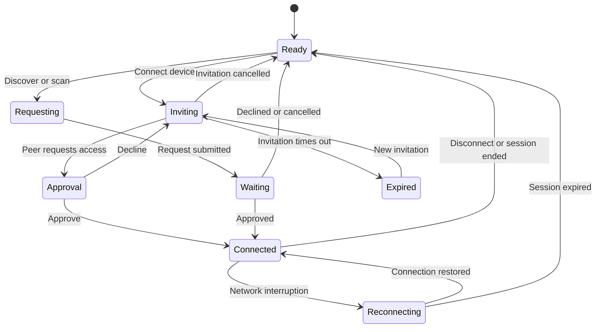

# Eluno — Screens and interaction flows

Phase 0 design specification. Native device permissions and installers are specified here; they are not implemented by the browser feasibility preview.

## Screen inventory

| Screen/state | Main content | Primary action | Recovery / alternate action |
| --- | --- | --- | --- |
| Welcome | Eluno, brief purpose, device name | Continue | Help |
| Computer setup | Install/open companion, progress, clear completion | Open Eluno | Retry installation / support |
| Devices, empty | This device, explanation of connecting | Connect device | Join a connection |
| Nearby devices | Recognizable names and connection availability | Select device | Scan QR / refresh |
| Invite | QR, expiring code, invitation instructions | Wait for request | New invitation / cancel |
| Join | Discovered companion or scanned invitation, confirmation code | Request connection | Scan again / cancel |
| Approval | Requesting device name, pairing confirmation | Approve | Decline |
| Waiting | Which device needs to approve | Wait | Cancel request |
| Permission explanation | What is needed and why, limited to the requested activity | Continue to system prompt | Not now |
| Permission denied | Which operation is unavailable and how to recover | Try again / Open settings | Back to Devices |
| Connected | Both device names, session/sharing status | Add media | Disconnect |
| Shared, empty | Clear empty state and source selection | Add media | Devices |
| Shared, populated | Name, media kind, source, availability for each item | Play / View | Stop sharing for own items |
| Video | Integrated controls, title, source | Play/pause | Seek, fullscreen, close |
| Photos | Integrated image viewer, title, source | Next / previous | Zoom, close |
| Source unavailable | Device name and keep-open guidance | Try again | Return to Shared |
| Connection lost | Reconnecting status; preserve list without implying current access | Retry | Reconnect devices |
| Unsupported content | Plain description; preserve source file | Choose another file | Close |
| Pairing expired | Expired invitation status | New code / scan again | Cancel |
| Sharing stopped | Item removed; active viewer closes | Return to Shared | Add another item |
| Session ended | Access ended; no lingering Connected indicator | Connect again | Done |

## Layout sketches

Desktop workspace:

```text
┌ Eluno ─────────────────────── Devices / Shared / Settings ┐
│ Connected: Living room PC ↔ My Android        Disconnect  │
│                                                         │
│ Shared with this connection                 + Add media  │
│ Video name       From Living room PC        Play  Stop   │
│ Photo name       From My Android            View         │
│                                                         │
│ Only selected items are shared. Stop sharing anytime.    │
└─────────────────────────────────────────────────────────┘
```

Phone workspace:

```text
┌ Eluno ───────────────────┐
│ Connected to             │
│ Living room PC           │
│                          │
│ Shared       + Add media │
│ [Video]                  │
│ Title / source     Play  │
│ [Photo]                  │
│ Title / source     View  │
│                          │
│ Devices  Shared Settings │
└──────────────────────────┘
```

## Connection state model



## Sharing and viewing rules

- Both clients expose Add media and both can view shared items. Sharing direction follows the item's source device.
- Permissions follow user intent. Selecting photos must not request camera or microphone access.
- Session participants can view the items shared into that session; this access is explained before sharing.
- Display an item as available only when its source can answer reads. On interruption, keep the title visible with an unavailable/retry state.
- Opening a viewer requests media access for that item. A title or thumbnail is not an access credential.
- Closing a viewer stops its transport requests. Stopping a share revokes outstanding grants and removes the item on both clients.
- Ending a session clears its access and returns all participants to the connection screen.
- A network change does not silently trust a new device. Reconnection must retain authenticated identity or require fresh pairing.
- Screen rotation preserves playback position in the production app. Verify this on physical Android devices.

## Prototype coverage

Implemented browser states: Welcome, Connect, Invite/QR, Join, Waiting, Approval/Decline, Connected, Shared empty/populated, Video, Photos, retryable playback error, Stop, Disconnect, and code renewal.

Not yet implemented: native installation, actual Android permission prompts, automatic nearby discovery, native camera QR scanning, native background/lifecycle behavior, and production screen-rotation persistence. These require the platform application and hardware acceptance work.
