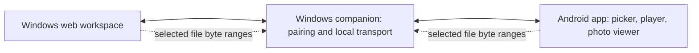

# Eluno — Feasibility architecture decision

Decision date: 22 October 2026. Status: preferred direction; provisional until the Android hardware gate passes.

Implementation update, 24 October: the 0.2.0 codebase uses an Electron Windows shell, JavaScript ESM core with TypeScript contracts, and a native Java Android client with Media3. The initial TypeScript/Kotlin preferences below were provisional options. See [current architecture](../ARCHITECTURE.md) for implemented choices and remaining acceptance gates.

## Chosen direction

A Windows companion coordinates temporary device sessions and serves media to the local web workspace and native Android client. Both clients can be media sources. Files remain at their source and are read in bounded byte ranges; a receiver can seek without a whole-file pre-copy.

This prototype uses Node.js and a buildless web UI to test the transport contract. It does not select the final desktop packaging framework. A TypeScript-based companion/web core and a Kotlin Android client with platform media and discovery APIs are the preferred candidates for Phase 2. These are architecture choices, not claims of an existing native build.

For the prototype, an Android-sized browser client stands in for the planned Android app. Two desktop browser clients validate the protocol in both directions. No physical Android compatibility is inferred from that experiment.

## Options evaluated

| Option | Advantages | Tradeoffs | Decision |
| --- | --- | --- | --- |
| Browser-only peer-to-peer | Potential direct data path; shared UI | Needs signaling; file seeking/serving adds complexity; background source reliability and discovery require platform validation | Keep as a future experiment |
| Windows companion + native Android | Clear ownership of local transport, file access, discovery, and Android lifecycle | Requires installation, packaging, and native testing; computer remains running | Preferred first release |
| Cloud media relay/storage | Easier endpoint reachability across networks | Bandwidth/storage expense, account/privacy requirements, and internet dependency | Defer |
| Copy entire files before viewing | Simplifies some player integrations | Delays playback and adds storage requirements | Does not meet the initial streaming experience |

## What the prototype establishes

- A selected browser File can supply individual byte ranges through a local companion to another browser's native media element.
- The protocol is symmetric: either client can own and serve a selected file.
- HTTP Range supports random access. Each source read is capped at 256 KiB; the companion forwards chunks rather than retaining whole media files.
- Pairing codes expire after five minutes, joining requires explicit creator approval, pending requests expire after one minute, and prototype sessions expire after 30 minutes.
- Unsharing, leaving, and ending a session invalidate associated media grants and pending reads.
- Media bytes are not written to disk by the companion. Browser/media buffers are outside that statement.

These conclusions come from the local tests in this repository, not from assumptions about mobile OS behavior.

## Discovery and invitation contract

Production: advertise/discover a specific Eluno service through platform DNS-SD/NSD support; permit discovery only when needed. Use a QR invitation when discovery fails. The QR must identify the companion endpoint plus invitation and trust information. A six-digit code alone cannot discover an arbitrary local endpoint.

Prototype: QR generation and code/approval work. A standalone DNS-SD experiment successfully exchanged PTR/SRV/TXT/A records between sockets on this Windows computer's loopback interface. It is not integrated into the browser UI and does not establish Android discovery. An optional LAN mode lists local interface addresses for an engineering experiment; cross-device discovery and camera scanning are not proven. The address selector is a development control and must not become the consumer onboarding flow. The discovery design follows [Android NSD](https://developer.android.com/develop/connectivity/wifi/use-nsd); the disposable probe uses the [multicast-dns library](https://github.com/mafintosh/multicast-dns).

Android's current local-network permission guidance depends on target SDK and provides system-mediated discovery alternatives. Recheck the official rules against the chosen target SDK during native implementation. See [Android local-network permission guidance](https://developer.android.com/privacy-and-security/local-network-permission).

## Transport and trust

Prototype mode defaults to loopback. Optional LAN experiments use HTTP and disposable test media only. This is a feasibility tool, not a secure deployment for personal content. Bearer tokens authorize device operations; separate random media tickets authorize the native media element. Tickets expire with the session and are invalidated on revocation. They must not be logged or persisted.

Production requirement: encrypted LAN transport and authenticated device identity established through pairing. The preferred native path uses a companion certificate/public-key fingerprint carried through the invitation and pinned by the Android client. The Windows web workspace talks to its own local companion. Prove trust bootstrap and reconnection on hardware before committing to this arrangement; a raw self-signed HTTPS browser page is not an acceptable consumer setup.

Browser secure-context rules matter for camera scanning and other privileged APIs: localhost behavior does not establish that an HTTP LAN address has the same capabilities. See [MDN secure contexts](https://developer.mozilla.org/en-US/docs/Web/Security/Defenses/Secure_Contexts).

Prototype safeguards include exact local-host validation, cross-origin rejection, request-size bounds, code-guess rate limits, file-type allowlisting, session membership checks, and no raw filesystem-path API. They do not provide encryption, complete denial-of-service protection, or a production security review.

## Mobile lifecycle contract

Launch promise: keep Eluno open and the sharing device awake. Show a source-unavailable state on interruption; retry range reads when it returns. A tab reload loses selected File objects and ends that preview session.

Native background behavior requires its own validation. Android foreground services have notification, start, type, and duration rules; a media-playback service must not be assumed to authorize arbitrary file hosting. See [Android foreground services](https://developer.android.com/develop/background-work/services/fgs) and [background task guidance](https://developer.android.com/develop/background-work/background-tasks).

## Media compatibility decision

| Content | Initial target | Prototype handling |
| --- | --- | --- |
| MP4 H.264/AAC | Baseline video target | Byte-range delivery and browser player; device codec checks still needed |
| WebM VP8/VP9 | Additional candidate | Allowed; generated VP8 sample used for browser QA |
| JPEG / PNG | Baseline photos | Allowed and displayed in integrated viewer |
| WebP | Additional candidate | Allowed; needs device matrix validation |
| HEVC, AV1, MOV, MKV, HEIC, RAW | No first-release guarantee | Unsupported extensions are rejected; allowed containers with unsupported codecs produce a recoverable viewer error |

A container/extension does not establish that a device can decode every codec inside it. Use capability checks plus actual sample playback. No conversion engine is included. Consider an optional conversion pipeline only if beta evidence warrants the installation size, licensing review, and CPU cost. See [Android supported formats](https://developer.android.com/media/platform/supported-formats), [MDN video codecs](https://developer.mozilla.org/en-US/docs/Web/Media/Guides/Formats/Video_codecs), and [HTTP Range requests](https://developer.mozilla.org/en-US/docs/Web/HTTP/Guides/Range_requests).

## Operating cost

The running prototype calls no external media, signaling, discovery, analytics, or storage service. QR codes are generated locally. Media remains within the local companion/client path.

Local operation adds no cloud-media bandwidth or storage bill. This does not mean the finished product has zero cost: web hosting, code signing, distribution, support, and future update infrastructure need a budget. Any future internet relay requires an explicit bandwidth cost model before release.

## Known limits and next decision

The computer is required as the session companion. Browser background operation, phone lock/unlock, actual Wi-Fi isolation/firewall behavior, Android permissions, automatic discovery, certificate pinning, physical large-file playback, and real mobile format support remain unverified.

Proceed to a native Windows/Android transport experiment using the same range/session contract. Keep the Phase 1 acceptance gate open until the physical-device matrix in [DEVICE_VALIDATION.md](DEVICE_VALIDATION.md) has evidence.
